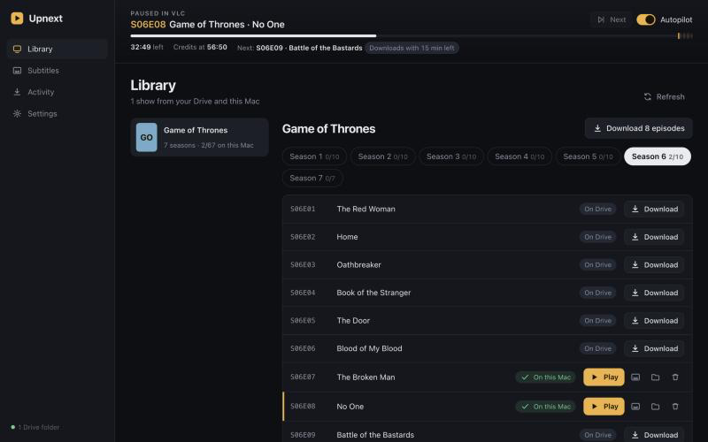

# Upnext

A desktop app for binge-watching your own shows from Google Drive in VLC. Pick any show and season from your Drive, and Upnext keeps the next episode downloaded before you need it. When the end credits start, it shows a countdown and plays the next one. Every episode gets English subtitles: found online, synced to the speech, or generated on your machine, then put inside the video file.



I built it with Claude Code. It started as a 100-line script that pre-downloaded the next Game of Thrones episode from my Drive, and grew from there. The ideas and the decisions are mine: credits instead of a fixed timer, the subtitle fallback order, keeping it all local. So is checking the subtitle-timing idea against a real file, which is what killed it (see `NOTES-AI.md`).

## What it does

- **Library.** Paste one or more Drive folder links. Upnext reads every video in them, works out the show, season and episode from messy release names (`Game.of.Thrones.S06E05.The.Door.1080p…`, `breaking_bad_3x07`, `Show/Season 2/S02E01.mkv`) and lists them by show and season. Episodes already on your computer show up too.
- **Downloads.** One episode or a whole season, with live progress. rclone pulls 16 streams at once, which measured about 4x faster than one (10 vs 2.6 MB/s on my connection, 45 MB/s on a better one).
- **Autopilot.** While VLC plays, Upnext downloads the next episode once 15 minutes are left. When the credits start it shows an Up Next card with a countdown, then plays the next episode, fullscreen if you were. After a season finale it moves on to the next season.
- **Credits detection.** Most shows end on white text over black. ffmpeg's `blackdetect` scans the last six minutes, and the run of black stretches that lasts to the end is the credits. On S06E05 it found the cut to the exact second (55:25).
- **Subtitles.** For each episode, in this order:
  1. An English track already inside the file: leave it alone.
  2. A `.srt` next to the video: sync it to the speech.
  3. Search OpenSubtitles. A file-hash match is made for this exact release and is used as is. Anything else gets synced.
  4. Nothing found, or no API key: transcribe the audio with Whisper. On Apple Silicon that's mlx-whisper on the GPU, elsewhere faster-whisper on the CPU. Timed on an M4 for a 50 minute episode: about 2 minutes with base, 5 with small (the default) and 10 with turbo. faster-whisper small on the CPU took about 20.
  5. Embed the result as the default English track (MKV and MP4). The `.srt` stays next to the video.

  The Subtitles page also does each step by hand: sync any `.srt` or text track you pick, shift by a few seconds, pick a different OpenSubtitles result, regenerate, or embed.

- **Syncing.** Whisper transcribes the episode word by word. Every subtitle line whose first four words are heard (and appear in no other line) becomes an anchor, and a line is fitted through a few hundred of them: offset plus speed, so a 25 vs 23.976 fps release is fixed too. If the release has a cut the subtitles don't, the offset is followed piece by piece instead. Any offset works. My S07E04 `.srt` was 84 seconds late, which ffsubsync (60 second limit) turned into a wrong -60s fix. This matched 239 lines and put them within 0.14s of the speech, in 2 minutes on an M4. The transcript is cached, so syncing again is instant. ffsubsync is only the fallback when too few lines match.

## Run it

You need Python 3.11+, VLC, ffmpeg and rclone.

**macOS**

```bash
./scripts/make_mac_app.sh
```

That installs everything (Homebrew for ffmpeg, rclone and VLC) and builds `~/Applications/Upnext.app`. Open it from Spotlight and drag it to the Dock.

**Windows.** Install Python from python.org, then `winget install Gyan.FFmpeg Rclone.Rclone VideoLAN.VLC`, and double-click `Upnext.bat`.

**Linux, or any system from a terminal**

```bash
./scripts/setup.sh
.venv/bin/python -m upnext            # app window
.venv/bin/python -m upnext --browser  # or in your browser at http://127.0.0.1:8765
```

## First run

1. Settings, then Connect Google Drive. Your browser opens to sign in. Upnext only asks for read access.
2. Paste a Drive folder link that has your shows in it and press Add folder.
3. For downloaded subtitles, make a free account at opensubtitles.com, create an API consumer, and paste the key in Settings. Without one, subtitles are generated with Whisper.
4. Library, pick a show, press Play. Leave Upnext open while you watch.

## How it's built

```
upnext/
  __main__.py   starts the server, the workers and the window (pywebview)
  server.py     FastAPI routes the UI calls
  library.py    Drive listing plus local files, grouped into shows and seasons
  names.py      release file name -> show, season, episode, title
  drive.py      rclone: listing, sign-in, download command
  downloads.py  download jobs with progress parsed from rclone's JSON log
  vlc.py        VLC through its web interface (any OS), AppleScript fallback on macOS
  autopilot.py  watches VLC: prefetch, credits, Up Next, play next
  credits.py    blackdetect and the "black until the end" rule
  subtitles.py  OpenSubtitles, Whisper (MLX or CPU), syncing, ffmpeg embedding
  align.py      matching subtitle lines to the transcript and fitting the timing
  jobs.py       background jobs: downloads two at a time, subtitle work one at a time
  popup.py      the Up Next countdown window (Tk, so it floats over VLC)
ui/             one page, plain JS, no build step
```

Settings live in the OS app-data folder (`~/Library/Application Support/Upnext` on a Mac), never in the repo. Only settings you change are stored.

Upnext starts VLC itself with VLC's web interface on `127.0.0.1` and a random password. That's what makes it work the same on every OS. If you open VLC yourself on a Mac, it reads what's playing through AppleScript instead.

## Tests

```bash
.venv/bin/python tests/test_core.py
```

Covers name parsing, the credits rule on S06E05's measured black stretches, subtitle shifting and line wrapping, and alignment: a constant 84s offset, a 25 vs 23.976 fps speed difference, a 40 second cut partway through, and subtitles from the wrong episode (refused).

## Known gaps

- Picture-based subtitles (PGS from Blu-rays) can't be synced, only text ones.
- If the next episode's subtitles are still generating when it starts, VLC won't pick them up until you reopen the file.
- The OpenSubtitles free tier allows a handful of downloads a day.
- English only for now.
